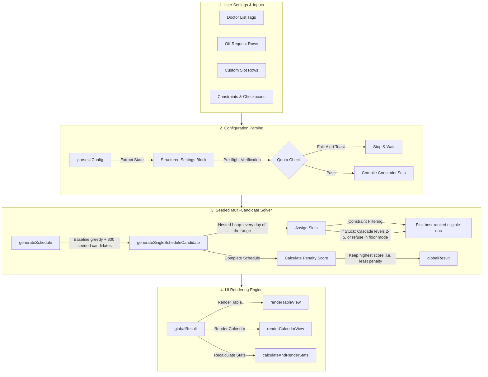
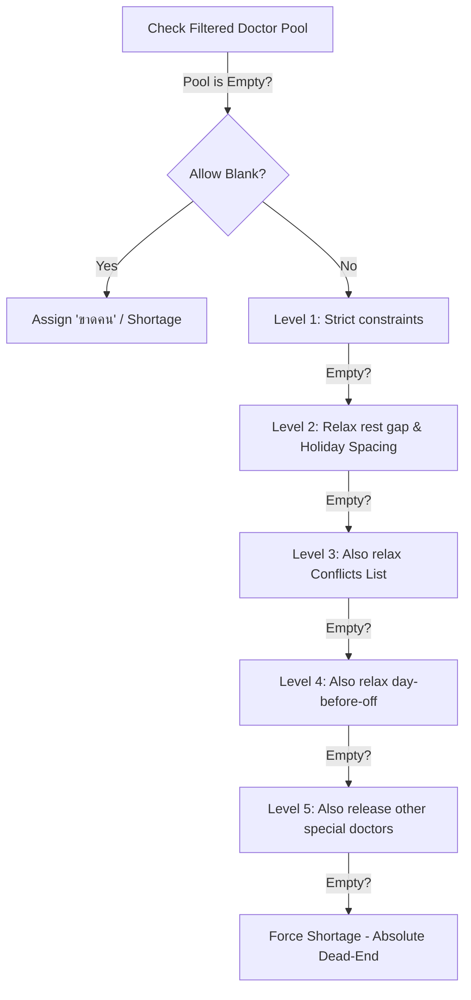

# 🩺 Deep-Dive Technical Reference & Logic Report

This document is a comprehensive, unrestricted guide to the codebase of the **Automatic On-Call & Night Shift Doctor Scheduler**. It details the mathematical formulas, algorithm steps, state management lifecycle, function APIs, security measures, and responsive designs used in the system.

---

## 🗺️ System Architecture & Data Flow

The application runs entirely on the client side inside the browser sandbox. It utilizes an event-driven flow where state mutations in configuration instantly trigger recalculations of the schedule candidate pool.



---

## 💾 Core State Management

The application's runtime memory is managed by several global variables declared at the top of `app.js`. Understanding these is critical to modifying behavior:

*   `doctors` (Array of Strings): The list of doctor names. Example: `["A", "B", "C"]`.
*   `offData` (Array of Objects): Stores requests for days off.
    *   *Schema*: `{ id: Number, date: String, names: String }` (where names is a comma-separated list).
*   `extraSlotsData` (Array of Objects): Custom shifts needed on specific calendar days.
    *   *Schema*: `{ id: Number, date: String, count: Number, slotsPerRole: Object }`.
*   `manualOverrides` (Object): Stores manual doctor swaps made directly by clicking cells.
    *   *Structure*: `{ [dayNumber]: { [slotIndex]: "Doctor Name" } }`.
*   `pendingOverrides` (Object or `null`): Overrides from an imported config, held until the next solver run commits them.
*   `globalResult` (Object): The winning schedule generated by the solver, stored as a **self-contained snapshot**: besides `schedule` it carries `originalSchedule` (the solver's own picks, never edited), `relaxations` (every rule the cascade gave up, see section 7), `carryOver` (the tail of this period, see section 8) and the config, doctors, dates and month/year it was built with. Code that renders, exports or edits the displayed result reads it through `resultCtx()` / `resultConfig()`, not live inputs.
    *   *Structure*:
        ```json
        {
          "schedule": [
            {
              "day": 1,
              "dayName": "Monday",
              "selectedDocs": [{ "name": "A", "role": "R1" }, { "name": "B", "role": "R2" }],
              "note": "Weekend / Holiday"
            }
          ],
          "month": 10,
          "year": 2026,
          "maxSlots": 3,
          "relaxations": []
        }
        ```
*   `currentLang` (String): Tracks active language. Values: `"th"` or `"en"`.

---

## 🧠 Detailed Breakdown of the Solver

The core scheduling problem is NP-hard, meaning the number of possible schedule combinations grows exponentially with the number of doctors, roles, days, and constraints. An exact approach often gets stuck. The solver instead runs a **baseline greedy pass (randomness 0) plus 300 candidate greedy passes** whose doctor ranking is perturbed by noise from a **seeded** generator (section 9), scores every candidate, and keeps the best. This is a deterministic search over perturbed greedy runs, not Monte Carlo randomness: identical inputs give an identical roster.

### 1. The Parser: `parseUIConfig()`
Before any scheduling runs, this function translates human input fields from the webpage into structured collections for the algorithm. *Note: All interactive UI components (dropdowns, chips, steppers) sync their data into hidden text fields (e.g. `inputDoctorRoles`, `inputConflicts`), preserving the parser's original comma-separated string logic.* It processes:
1.  **Doctor-to-Role Mapping**: Converts text like `A:R1, B:R2` into a fast key-value map: `{ "A": "R1", "B": "R2" }`.
2.  **Special Holidays**: Parses comma-separated holiday strings into a `Set` for $O(1)$ lookup speeds.
3.  **No-Duty Days**: Converts days with no active shifts into another lookup `Set`.
4.  **Unified Quotas**: Parses exact monthly limits into the unified `quota` dictionary. In Role-Based Mode, parses limits (e.g. `R1:12, R2:10`) into `{ "R1": 12, "R2": 10 }`. In Single-Pool Mode, parses per-doctor limits (e.g. `A:5, B:4`) into `{ "A": 5, "B": 4 }`. Values $\le 0$ are discarded, and unknown keys trigger warnings.
5.  **Off Requests (`offMap`)**: Parses comma-separated values and date ranges (e.g. `1, 3-5, 10` or `25/02/2026-04/03/2026`). In Custom Date Range mode, ranges are parsed using standard `DD/MM/YYYY` formats and expanded day-by-day crossing month boundaries. In Standard mode, ranges are evaluated as day-number integers. Validations are checked (inverted range errors, >90 day warnings) and elements are expanded into a fast-lookup `offMap`: `{ [dateKey]: Set(doctorNames) }`.
6.  **Conflict Lists**: Parses items like `A:B` into bidirectional sets: `{ "A": Set("B"), "B": Set("A") }`.
7.  **Locked Special Rules**: Extracts locked doctor arrays for specific early days of the month.
8.  **Custom Date Range Logic**: If `isCustomDateRange` is active, computes an exact timeline array (`scheduleDates`) of `Date` objects from the start to end date (up to 90 days), and normalizes the `totalDaysInMonth` loop boundary. Per-day slot overrides are matched by canonical `YYYY-MM-DD` (`normalizeSlotKey` also accepts `DD/MM/YYYY` or a bare day number, which resolves to its first occurrence in the range).
9.  **Rest gap, night floor, carry-over, seed**: Reads the 0-based Off Duty Period (section 11), `inputMinNightShifts` / `chkAllowExtraNightDoctor` (section 5), builds the cross-period `carryOver` (section 8) and the solver seed (section 9).

### 2. Pre-flight Quota Calculation
When any quotas are defined (`hasQuotas` is true), the algorithm runs a check:
$$\sum_{doc \in doctors} \text{Quota}[getQuotaKey(doc)] = \text{Total Slots for the Timeline}$$
If the total slots required for the timeline (considering custom slots and weekend configurations) does not match the sum of exact doctor quotas across all doctors, the solver aborts and prompts:
*   *Thai*: `"ข้อผิดพลาด: โควตารวม (X) แต่มีทั้งหมด Y ช่อง..."`
*   *English*: `"Error: Quotas sum to X but there are Y slots — add/remove shifts..."`

**Exception**: If **Allow Blank Days** (`chkAllowBlankDays`) is checked, the exact-sum check is bypassed so the solver can output blank slots (`ขาดคน`) for unbalanced configurations. Quotas that sum to *more* than the available slots are still refused, and `checkQuotaFeasibility` still reports per-doctor impossibilities (as a warning toast instead of an error when blanks are allowed). Quota mode never uses the night floor (section 5).

---

### 3. Loop Iterations: `generateSingleScheduleCandidate(config)`

`generateSchedule()` calls this function once with randomness 0 (the baseline) and then 300 times with randomness 0.85. Each call attempts to assign doctors for each day.

```text
FOR day = 1 TO totalDaysInMonth:
    1. Resolve real calendar date (`Date` object via Month/Year or `scheduleDates` array if custom range).
    2. Read slot configuration for this day (defaults or custom override).
    3. Determine if it is a holiday/weekend using the resolved `Date`.
    4. Loop through each slot index:
        a. Apply Filter Rules to eliminate ineligible doctors.
        b. If no doctors remain, trigger the Must-Fill Cascade.
        c. Rank the remaining pool (floor, quota, balance, gap, seeded noise) and take the first.
        d. Assign the doctor to the slot.
        e. Update the doctor's shift count: tCounts[doc]++.
```

#### A. Filter Rules & Constraints
During standard selection (Cascade Level 1), the solver filters out doctors using these tests:
1.  **Hard Quota Cap**: If `tCounts[doc] >= quota`, the doctor is excluded.
2.  **Role Isolation**: If the slot is designated for role `R2`, only doctors mapped to `R2` are allowed.
3.  **Double Shift Rule**: A doctor already assigned to a slot on `day` cannot be assigned to another slot on the same `day`.
4.  **Off Requests**: Excludes doctors who requested `day` off. Under standard mode, it also excludes doctors who requested `day + 1` off. Under Shift-Based mode, the day-before-off rule only applies to **Night shift slots** (a doctor with an off request tomorrow may still work Morning and Afternoon slots today).
5.  **Night-to-Morning Spacing (Shift-Based Mode)**: Under Shift-Based mode, a doctor assigned to any Night shift slot on `day - 1` is strictly excluded from all Morning shift slots on `day`.
6.  **Rest Gap (`restBroken`)**: Excludes a doctor who worked on any of the previous `offDutyPeriod - 1` days. The UI value is 0-based (section 11): gap 0 = no rest, 1 = no duty the day after a duty (`offDutyPeriod` 2), and so on. On day 1 the look-back also reads the carry-over (section 8).
7.  **Holiday Spacing (`holidayAdjacent`)**: If `day` is a holiday/weekend, excludes doctors who worked on the immediately preceding holiday/weekend day (including across the period boundary on day 1).
8.  **Special-pool hold**: On a locked day, other special-pool doctors are held back for the locked pick.
9.  **Conflict List**: Excludes doctor `A` if doctor `B` is already scheduled on the same day and `A` is in `B`'s conflict list.

#### B. The Must-Fill Cascade (Fallback Levels)
If all doctors are filtered out and the slot is empty:
*   **If "Allow Blank Days" is ON**: The slot is left as `SHORTAGE_MARKER` (`ขาดคน`), and the solver continues.
*   **If "Allow Blank Days" is OFF and the night floor is 0**: The solver progressively disables constraints in a 5-step fallback to avoid a blank slot (every relaxation is recorded, section 7).
*   **If the night floor is above 0**: the rest rule is never relaxed (section 6); the cascade still relaxes holiday spacing, conflicts, day-before-off and the special hold, but never rest.



The levels are cumulative; each one drops one more rule from the previous level (verified against `generateSingleScheduleCandidate` in `app.js`). **The cascade runs only when Allow Blank Days is OFF**; with it ON, an empty level 1 pool leaves a shortage.

*   **Level 1 (`strictOk`)**: Not already working today, not off today or (standard mode) the day before an off day, no night-to-morning clash, rest gap (`offDutyPeriod`) respected, no consecutive holiday duty, no conflict with a doctor already chosen today. Doctors reserved for the locked special rule are also held back.
*   **Level 2**: Drops the rest-gap and consecutive-holiday rules (recorded as `spacing`). In floor mode the rest gap stays enforced and only holiday spacing is dropped.
*   **Level 3**: Also drops the conflict list (`conflict`).
*   **Level 4**: Also drops the day-before-off rule (`dayBeforeOff`; the actual off day still blocks).
*   **Level 5**: Also lets the other special-pool doctors be used (`special`). Only the safeguards below remain (plus rest in floor mode).
*   **Absolute Safeguards (Never Disabled)**:
    1.  **Hard Quotas**: A doctor who hit their limit is never picked.
    2.  **Role Isolation**: An `R1` slot will never receive an `R2` doctor.
    3.  **Uniqueness**: A doctor will never work two slots on the same day.
    4.  **Requested Day Off**: A doctor is never assigned on a day they asked off.
    5.  **Night-to-Morning Spacing (Shift-Based Mode)**: A doctor on a Night slot on Day $d-1$ never works a Morning slot on Day $d$.

**Special (locked) doctor pick**: on a locked day the special doctor is chosen from `specialDocs` using the same `strictOk` hard rules as a normal pick (including the rest gap; plus quota), not by bypassing them. If no special doctor passes, the slot falls through to the normal pick and cascade. Doctors removed from the app are removed from the lock pool.

10. **Heuristic Workload Balancing (`balanceShifts`)**: When enabled, the sorting of candidate doctors dynamically prioritizes those with the lowest shift counts (total, workday, or holiday) by resolving any non-zero workload difference during candidate generation (the `0.4` tolerance is used only by the `preventLongGaps` last-worked comparison). This ensures tighter, more balanced shift allocation across the pool.
11. **Quota Density Sorting Heuristic**: To prevent late-month shortages for doctors with off requests, the sorting of candidate doctors dynamically prioritizes doctors with higher **Quota Density**:
    $$\text{Quota Density} = \frac{\text{Remaining Quota}}{\text{Remaining Available Days}}$$
    Where $\text{Remaining Quota} = \text{Quota} - tCounts[doc]$ and $\text{Remaining Available Days}$ is the number of remaining days in the schedule timeline where the doctor has no off requests. This ensures doctors with a more constrained availability are scheduled on their available days first, preserving doctors with wider availability to cover dates where others are off. The remaining-availability counts come from a per-candidate cache (section 10).
12. **Candidate ranking order (`sortDoctors`)**: (0) night floor, when active (section 5); (1) quota fulfilment and quota density; then, with `balanceShifts`, holiday or workday count and total count (each plus seeded noise); then, with `preventLongGaps`, the least recently worked; finally the noise alone.

---

### 4. Schedule Evaluation: Scoring & Penalty Math

Once a candidate schedule is built, the solver evaluates its quality by calculating a **Penalty Score**. 

$$Penalty = (S \times 15000) + (F \times 100000) + R + (G \times 80) + (\sigma_{total} \times 600) + (\sigma_{holiday} \times 1200) + (\sigma_{workday} \times 300) + V_{shift} + W + P$$

`scoreSchedule` returns the negative of this penalty, so the **highest** returned score (closest to 0) is the best candidate.

Where:
*   **$S$ (Shortages)**: Number of unfilled slots (`ขาดคน`), 15000 each.
*   **$F$ (Floor shortfall)**: Total missing shifts below the night floor across all doctors, 100000 each, so any shortfall loses to any roster without one (section 5).
*   **$R$ (Relaxation penalties)**: Per recorded relaxation: `conflict` 50000, `dayBeforeOff` 5000, `spacing` 1000, `special` 1000 (section 7).
*   **$G$ (Gap Spacing Violations)**: For each pair of consecutive duties of a doctor closer than the internal `offDutyPeriod`, `(offDutyPeriod - gap) x 80`.
*   **$\sigma_{total}, \sigma_{holiday}, \sigma_{workday}$ (Workload Variances)**: Standard deviations of total shifts assigned, holiday/weekend shifts assigned, and workday shifts assigned across the active doctor pool.
*   **$V_{shift}$ (Shift Alternation Variance Penalty)**: Under Shift-Based mode, a variance penalty is calculated for each doctor based on the distribution of their Morning, Afternoon, and Night shifts to encourage fair rotation:
    $$V_{shift} = \sum_{doc \in doctors} \text{Variance}(\text{Morning}_{doc}, \text{Afternoon}_{doc}, \text{Night}_{doc}) \times 600$$
*   **$W, P$ (Soft alternate, `chkSoftAlternate`)**: $W$ counts extra duties by the same doctor inside any 3-day window times `windowPenalty` (150; low 50, high 300); $P$ counts repeats of the same duty group on different days times `pairPenalty` (300; low 100, high 600).

A schedule with a **smaller penalty** (higher score) is more balanced and contains fewer rule violations. The solver scores the baseline first, then each of the 300 candidates, and replaces the best only on a strictly higher score, so ties keep the earlier candidate.

---

### 5. Night Floor & Extra-Doctor Plan

**Inputs**: "Minimum shifts per doctor" (`inputMinNightShifts`, UI default 14, clamped 0..60, **0 disables**) and "Allow an extra doctor on a night" (`chkAllowExtraNightDoctor`, default on). If either element is absent the parser falls back to 0 / on.

**Where it applies** (`floorApplies` in `parseUIConfig`): standard, role-based and shift-night (non-role) rosters. Role+shift rosters and quota mode use the legacy solver and show a one-time warning toast. What counts toward the floor: every duty in standard/role mode (`tCounts`); only Night slots in shift mode (`nCounts`).

**Plan** (done once in `parseUIConfig`; any failure is stored in `floorPlan.error` and thrown by `generateSchedule` before solving):
1.  `baseSlots` = slots on all duty days (night slots only in shift mode); `required` = doctors x floor; `maxSlots` = `baseSlots` + one possible extra per duty day.
2.  **Per-doctor capacity**: earliest-first count of days the doctor can work given off requests and the rest gap. Below the floor, refuse: "Dr. X: minimum N shifts, but at most M are possible".
3.  **Calendar arithmetic**: `required > maxSlots` refuses with the exact numbers (e.g. 70 required, 60 available). `required > baseSlots` with extras switched off also refuses.
4.  `extrasNeeded = max(0, required - baseSlots)`. `chooseExtraNightDays` picks that many nights, **at most one extra per night**, spread evenly across the range, weekdays before holidays.
5.  **Role need**: in role-based mode each extra is assigned a role, once, at plan time: the role with the largest remaining shortfall (`doctors in role x floor - role's base slots`). If the total role shortfall exceeds `extrasNeeded`, refuse ("impossible per role"). Non-role rosters add the extra to `Default`.

**Ranking** (`sortDoctors`, priority 0): below-floor doctors first, then fewer shifts first. In shift mode the ranking depends on the **slot kind**: day (morning/afternoon) slots keep below-floor doctors free for nights and prefer doctors with more nights; night slots favour below-floor doctors.

**Result checks**: after the search, any shortage in floor mode refuses (section 6), and a final verification refuses with per-doctor counts (`doctor got a/N`) if anyone is below the floor. Score: shortfall costs 100000 per missing shift (section 4).

**Display**: the note above the results reads `Plan: N slots + M extras = total shifts → X each` (Thai equivalent in `app.js`), shown only when the floor is active.

### 6. Floor-Mode Rest Rule

With the floor above 0, `restBroken` is **never** relaxed: cascade levels 2 to 5 all keep `floorMode && restBroken(doc)` as an exclusion. If a slot cannot be filled without breaking rest, it stays a shortage in that candidate; if the best candidate still has a shortage, `generateSchedule` throws "Cannot fill day X, Y without breaking the rest rule" naming the days (add a doctor, lower the minimum or reduce the gap). Floor mode therefore never ships a shortage or a rest violation. With the floor at 0 the legacy cascade (levels 2 to 5, section 3B) applies, rest included.

### 7. Relaxation Telemetry & Penalties

Whenever the cascade picks a doctor at level 2 or deeper, the candidate records, for each rule the **chosen doctor really breaks** (not just the level's label), `{ day, slot, level, kind, doctors }`:

| kind | level | meaning | score penalty |
|---|---|---|---|
| `spacing` | 2 | rest gap or back-to-back holiday broken | 1000 |
| `conflict` | 3 | works with a conflicting doctor | 50000 |
| `dayBeforeOff` | 4 | works the day before their off request | 5000 |
| `special` | 5 | a held-back special-pool doctor used | 1000 |

(`RELAX_PENALTY` in `app.js`.) The penalties are subtracted in `scoreSchedule`, so candidates that bend fewer or cheaper rules win. The winner's list is copied into `globalResult.relaxations`; `renderRelaxations()` shows it in `#relaxationPanel` (hidden when empty, `role="status"` with `aria-live="polite"`), grouped one line per day with the doctors named, with translated `relaxKind_*` labels. The success toast appends the warning count. The list describes the solver's own roster and is not recomputed after manual edits.

### 8. Cross-Period Carry-Over

`buildCarryOver(result)` records, per doctor, the duties in the last `max(offDutyPeriod, 2)` days of a result as `{ date, type: 'night' | 'duty', holiday }`. It is rebuilt from the **live schedule**, so manual edits are included, and also stored on `globalResult.carryOver` after overrides are applied.

`parseUIConfig` passes it to the next run only if the new period starts the day right after the previous result's last date **and** the doctor set (sorted) is identical. Otherwise it is ignored (re-running the same start date keeps that result's own carry-in). On day 1 it feeds the rest gap, the holiday-adjacency rule and, in shift mode, the night-to-morning rule; `validateEdits` reads the same record.

### 9. Determinism

`parseUIConfig` computes `solverSeed = hashString(JSON of the inputs that shape the roster)` (doctors, off requests, extra slots, period, mode flags, default and per-role slot counts (not the shift-mode Morning/Afternoon/Night counts), quotas, rest gap, floor settings, holidays, no-duty days) and creates `config.rng = mulberry32(seed)`. All ranking noise comes from that one generator, consumed in a fixed order by the baseline and the 300 candidates, and ties keep the earlier candidate. Same inputs, same seed, same roster; `Math.random` is only a fallback when a config has no `rng`. Changing any seeded input changes the seed and hence the search.

### 10. Remaining-Availability Cache

Quota-density ranking needs "days left on which this doctor has no off request" for every comparison. `generateSingleScheduleCandidate` builds `remainingAvailableByDoctor[doc]` once per candidate as a suffix-count array (only when quotas are set) and reads it in O(1), instead of rescanning the rest of the range per comparison (previously quadratic in range length). Reported speed-up for 90-day ranges with quotas: about 3x (not re-measured here).

### 11. Input Guards

*   **Slot counts**: default slots per day clamp to 1..10 (NaN falls back to 2). Shift-mode Morning/Afternoon/Night counts clamp to 0..10 (NaN becomes 1; all zero becomes 1/1/1). A single-number per-day role-slot override is capped at 50. Negative or NaN counts never throw.
*   **Off Duty Period**: UI is 0-based, clamped 0..6 (0 = no gap, 1 = one day off after a duty; NaN gives 1). The solver keeps `offDutyPeriod = UI + 1` internally. Exports carry `configVersion: 2`; older files are migrated by subtracting one.
*   **Floor**: clamped 0..60, NaN gives 0.
*   **Dates**: `parseDateDDMMYYYY` rejects impossible dates such as 31/02/2026 (no rollover to 03/03), accepts Buddhist-era years (>2500 minus 543) and two-digit years (+2000). Inverted off-request ranges are rejected with a toast; ranges over 90 days are refused or warned. A custom range needs start strictly before end (start >= end is rejected) and at most 90 days.
*   **Custom-range slot overrides**: keyed by canonical `YYYY-MM-DD`; `DD/MM/YYYY` and a bare day number are normalised to it.

---

## 🔒 Lock Special Duty — Advanced Queue Locking

The **Lock Special Duty** feature pins exactly one doctor from a defined pool (`specialDocs`) to every qualifying day. It operates in two modes selectable by the `lockConditionType` UI field.

### Mode 1 — First N Days (default)

When `lockConditionType = "firstNDays"`, the solver reads two inputs:

| Input | ID | Default |
|---|---|---|
| Start day (inclusive) | `inputSpecialStartDay` | 1 |
| End day (inclusive) | `inputSpecialDays` | 14 |

All integers from `startDay` to `endDay` are added to the `specialRuleDays` Set (see the Special Rule Locks section below). The solver condition `specialRuleDays.has(day)` is $O(1)$, so no comparison trickery is needed.

### Mode 2 — Every [Weekday]

When `lockConditionType = "everyWeekday"`, `parseUIConfig()` scans every calendar `Date` object in the schedule window and collects the 1-based day indices where `date.getDay() === lockWeekday` into the `specialRuleDays` Set.

For **standard month ranges**, `new Date(year, month-1, d)` is used. For **custom date ranges**, the pre-built `scheduleDates` array is used directly — correctly spanning month and year boundaries.

If no matching weekdays exist in the range, a non-fatal warning toast is emitted and the solver continues without crashing.

### Special Rule Locks — Internal Design

```javascript
const specialRuleDays = new Set();   // locked 1-based day numbers
// firstNDays:  startDay..endDay added directly
// everyWeekday: days whose Date.getDay() === lockWeekday
```

The solver and the note renderer query the Set explicitly (`specialRuleDays.has(day)`), so lock evaluation is deterministic and has no hidden state. (An earlier implementation used a `valueOf()` proxy that sniffed `arguments.callee.caller` and `Error().stack` to guess the current day during numeric comparisons; it was removed as fragile and unnecessary.)

### Rest and Holiday Rules Apply

Locked doctors are **not** exempt from the rest gap or the consecutive-holiday rule. The special pick uses the same `strictOk` rules as a normal pick (rest gap, holiday spacing, off requests, night-to-morning, conflicts) plus the quota ceiling. If no pool doctor passes on a locked day, the slot falls through to the normal pick and cascade, so a locked day can end up with a non-pool doctor rather than a rest violation. (An older version exempted locked doctors; that was removed and `tests/constraintCoverage.test.js` TEST 3 asserts the current behaviour.)

---

## 💻 Detailed Function Reference


Here is a detailed breakdown of the functions in `app.js`:

### 🧬 Core Algorithmic Functions

#### `generateSchedule()`
*   **Type**: Asynchronous; yields to the event loop between chunks so the UI stays responsive. Concurrent calls are coalesced (`regenPending`).
*   **Responsibility**: The entry point for schedule calculation. It parses inputs (`parseUIConfig`), runs the baseline pass and the 300 seeded candidates, applies the failure checks, commits the winner to `globalResult`, re-validates manual overrides, and renders.
*   **Code Design** (simplified):
    ```javascript
    const config = parseUIConfig();          // throws on infeasible input (quota or floor arithmetic)
    if (config.floorPlan && config.floorPlan.error) throw new Error(config.floorPlan.error);

    let bestCandidate = generateSingleScheduleCandidate(0, config);   // baseline greedy
    let bestScore = scoreSchedule(bestCandidate);

    const iterations = 300, batchSize = 30;                            // 10 chunks of 30
    for (let i = 0; i < iterations; i += batchSize) {
        for (let j = 0; j < batchSize && i + j < iterations; j++) {
            const candidate = generateSingleScheduleCandidate(0.85, config);
            const score = scoreSchedule(candidate);
            if (score > bestScore) { bestScore = score; bestCandidate = candidate; }
        }
        await new Promise((r) => setTimeout(r, 0));                    // yield
        if (regenPending) return;                                      // inputs changed: stale run
    }
    // floor mode with any shortage -> refuse naming the days (section 6)
    // floor mode below the minimum -> refuse with per-doctor counts (section 5)
    globalResult = { schedule, originalSchedule, relaxations, ...snapshot };
    pruneOverrides(...); applyManualOverrides(config);                 // section 4 of the override pipeline
    ```
*   **Toasts**: Success shows `Schedule calculated successfully with Smart Solver!` plus ` (N warnings)` when `relaxations.length > 0`. A result with shortages shows a warning toast instead. A roster that is entirely shortages is rejected as impossible.

#### `generateSingleScheduleCandidate(randomness, config)`
*   **Inputs**: `randomness` (0 = pure greedy, >0 = scales the seeded ranking noise), `config` (object containing parsed constraints, including the seeded `rng`).
*   **Outputs**: A candidate `{ schedule, summary, wCounts, hCounts, tCounts, nCounts, relaxations, maxSlots, config }`. It throws `Critical Coverage Error` when a role has no mapped doctor at all.
*   **Responsibility**: Builds a single schedule candidate. Contains the nested loops (days, slots) and applies the constraint validation logic and fallback cascades.

---

### 🎨 Rendering & DOM Generation

#### `renderTableView()` & `renderCalendarView()`
*   **Type**: DOM Manipulation.
*   **Responsibility**: Converts the `globalResult.schedule` data array into HTML grids and tables.
*   **Security Feature**: Before injecting doctor names into templates, they are passed through the `esc()` sanitizer.
*   **Responsive Selector Binding**: Injects `<button onclick="openCellDropdown(event, 'id')">` into each slot.
*   **Role Display Architecture**:
    *   **List View (`renderTableView`)**: When `isRoleBased` is ON, the role label (e.g. `R1`, `R2`) is extracted via `getSlotRole` and rendered below the duty column headers (e.g., `DUTY 1` with subtitle `R1`). Row cells display only the doctor's name. When OFF, headers show standard Duty titles and cells remain unchanged.
    *   **Calendar View (`renderCalendarView`)**: Strips role suffixes from all dynamic doctor name chips.
    *   **Person-Centric View (`renderPersonCentricView`)**: Renders a dynamic, color-coded role badge (e.g. `[R1]`) next to doctor names in the left-hand sticky column using `getRoleBadgeColorClass`. Cells display slot numbers without any role decorations.
    *   **Excel/Clipboard Exports**: Headers are dynamically appended with their respective roles (e.g. `Duty 1 (R1)`) when Role-Based mode is ON, keeping the data rows clean with just doctor names.

#### `getCellDropdownOptionsHtml(day, slotIndex, currentDoc, config)`
*   **Inputs**:
    *   `day` (Number): The calendar day.
    *   `slotIndex` (Number): The duty index on that day.
    *   `currentDoc` (String): The doctor currently occupying the slot.
    *   `config` (Object): Parsed configuration (required).
*   **Outputs**: HTML string representing the list of buttons.

---

### 🔧 Event & State Mutator Handlers

#### `updateDoctorAssignment(day, slotIndex, doctorIndex)`
*   **Inputs**:
    *   `day`: The day number.
    *   `slotIndex`: The slot index.
    *   `doctorIndex`: The index of the selected doctor in the global `doctors` array.
        *   `-1` maps to `SHORTAGE_MARKER` (`ขาดคน`).
        *   `-2` maps to empty (`-`).
*   **Responsibility**: Registers manual changes. It first validates the edit (`validateManualAssignment`; rejected edits change nothing and show a toast), then updates `manualOverrides`, updates the clicked cell in the DOM immediately, and automatically recalculates/renders the Individual Duty Summary table and Stats Dashboard.

#### `resetSlotToAuto(day, slotIndex)`
*   **Responsibility**: Clears a manual override. First validates that the solver's own pick is still legal next to the neighbouring overrides (a rejection leaves the override in place). Then deletes the key from `manualOverrides[day][slotIndex]`, updates the cell's UI immediately, and automatically recalculates/renders the Individual Duty Summary table and Stats Dashboard.

---

### 📁 Config Persistence & Serialization

#### `exportConfigJSON()`
*   **Responsibility**: Serializes the application's configuration state.
*   **Format**: Creates a JSON string (built by `getCurrentConfig()`) with the following schema, abridged (the real file also carries `quota`, the custom-range dates, shift-slot counts, `chkShiftBased`, `chkSoftAlternate` and more):
    ```json
    {
      "doctors": ["Dr. A", "Dr. B"],
      "offData": [{"id": 1, "date": "5", "names": "Dr. A"}],
      "extraSlotsData": [],
      "manualOverrides": { "12": { "0": "Dr. B" } },
      "inputs": {
        "inputMonth": "10",
        "inputYear": "2026",
        "inputDefaultSlots": "2",
        "inputSpecialHols": "23",
        "inputNoDuty": "",
        "inputDoctorRoles": "Dr. A:R1, Dr. B:R2",
        "inputDefaultRoleSlots": "R1:1, R2:1",
        "inputRoleQuotas": "R1:12, R2:10",
        "inputConflicts": "",
        "inputSpecialDays": "1",
        "inputSpecialDocs": "Dr. A",
        "inputOffDutyPeriod": "1",
        "inputMinNightShifts": "14"
      },
      "configVersion": 2,
      "checkboxes": {
        "chkRoleBased": true,
        "chkPreventLongGaps": false,
        "chkBalanceShifts": true,
        "chkAllowBlankDays": false,
        "chkUseSpecialRule": false,
        "chkAllowExtraNightDoctor": true
      }
    }
    ```

#### `importConfigJSON(event)`
*   **Responsibility**: Processes an imported JSON file.
*   **Validation**: Verifies that the JSON contains valid arrays for `doctors`, `offData`, and `extraSlotsData` to prevent crashes.
*   **Versioning**: Exports carry `configVersion: 2`. A file without it (version 1) stored Off Duty Period 1-based; the importer subtracts one (floor 0) so the 0-based UI shows the same real gap. A file without `inputMinNightShifts` sets the floor to 0 so older configs keep their legacy behaviour.
*   **Overrides**: Imported `manualOverrides` are held in `pendingOverrides` and adopted only when the next solver run commits; they are then re-validated (see the override pipeline below).
*   **Syncing**: Restores variables, fills in input fields and checkboxes, triggers layout redrawing, and runs the solver.

---

## 📝 Manual Override Pipeline & State Tracking

The application permits administrators to manually correct the generated schedule by mapping doctor index targets in `manualOverrides[day][slotIndex]`. 

### 1. Drag-and-Drop Cell Swap
Instead of relying purely on dropdowns, the layout leverages HTML5 DataTransfer events (`ondragstart`, `ondragover`, `ondrop`). 
- When dropped onto a new cell, the system intercepts the coordinate payload and calls `applyPairedEdits()` with both cells' new doctors.
- `applyPairedEdits()` validates the **final state of the whole swap** (`validateEdits` with both edits applied together), so the intermediate state, such as the same doctor briefly in two slots on one day, is never judged. If it fails nothing changes and a rejection toast is shown; if it passes, one undo snapshot is pushed and both cells are applied.

### 2. History State Stack (Undo)
Because clicking and dragging can occasionally result in accidental mistakes, the engine wraps manual mutations inside a tracker:
- Before any accepted change to `manualOverrides` (e.g. `updateDoctorAssignment`, `resetSlotToAuto`, `clearManualOverrides`), `pushToUndoStack()` executes. A rejected edit pushes nothing.
- `pushToUndoStack()` deeply clones (`JSON.parse(JSON.stringify(...))`) `manualOverrides` into an array capped at a depth of 20. The Undo button (`#btnUndo`) is shown only while the stack is non-empty.
- `undoLastAction()` (button, or `Ctrl+Z` outside text fields) pops the tail state, prunes overrides that name a doctor who no longer exists, then `applyManualOverrides()` **rebuilds every row from `globalResult.originalSchedule`**, re-validates the remaining overrides as a unit (section 4 below) and re-applies those that pass. An override that was undone therefore reverts to the solver's pick instead of staying stuck, and the views, summary table, fairness row and stats are repainted.
- **Reset-all** (`clearManualOverrides`) works the same way locally (it is itself undoable) and does not run the solver.

### 3. When overrides are kept or dropped (commit-only)
Overrides belong to a period (`overridesPeriod`, e.g. `10-2026`). They change only when a solver run **commits** its result, never on a failed or aborted run:
- A different period key clears `manualOverrides` and the undo stack (with a toast).
- `pendingOverrides` from an imported config replace `manualOverrides` and reset the undo stack.
- `pruneOverrides(doctors)` drops overrides naming doctors who are not in the committed result.
- Removing a doctor is **not undoable**, because undo would resurrect a ghost doctor; its overrides are pruned at the next commit.
- Regenerate requests made while a run is in progress are coalesced: `generateSchedule()` sets `regenPending` and returns the running promise, and the loop re-runs once with the latest inputs.

### 4. Override Validation & Re-validation

Every way of editing a slot (cell dropdown, drag/drop, person view, mobile sheet, reset-to-auto) goes through `validateEdits(config, edits)` **before anything changes**. It checks the displayed schedule with the edits overlaid and returns the first failing rule:

1.  `duplicate`: the doctor already holds another slot that day.
2.  `conflict`: the doctor conflicts with someone else on that day.
3.  `role`: (role-based) the doctor's role does not match the slot's role.
4.  `off`: the doctor requested that day off (or, in standard mode and for night slots in shift mode, the next day).
5.  `rest`: another duty within `offDutyPeriod - 1` days before or after, including carried-in duties near the start of the period.
6.  `holiday`: consecutive holiday/weekend duty, previous, next, or carried in.
7.  `nightToMorning`: (shift mode) a night slot followed by a morning slot the next day, in either direction.
8.  `quota`: the doctor would exceed their quota.
9.  `floor`: a doctor who was at or above the night floor would drop below it by losing a duty. A doctor already below the floor is not blamed for the edit.

A rejection shows a translated toast (Thai/English) of the form `Cannot edit (<rule>): <detail>`, built from the `editReason_*` and `editDetail_*` keys in `translations.js`.

**Re-validation.** Overrides were made against an older solver result, so `applyManualOverrides()` (called on regenerate commit, import commit and undo) rebuilds the schedule from `originalSchedule`, then validates the whole override set as one unit. While it fails, it drops the latest day / highest slot override and re-checks. Invalid overrides are removed from `manualOverrides`, and one toast (`toastDroppedOverrides`) reports how many and which days.

---

## 📱 Mobile Layout Responsive Mechanics

To provide a smooth experience on mobile devices, the interface adapts based on screen size:

1.  **Detection**: The click event is intercepted by `openCellDropdown()`.
2.  **Layout Selection**:
    *   **Desktop (`window.innerWidth >= 768px`)**: Toggles the `.hidden` class on the cell's absolute-positioned dropdown div.
    *   **Mobile (`window.innerWidth < 768px`)**: Ignores the cell's absolute container. Instead, it creates a global full-screen fixed overlay (`#mobileDoctorModal`).
3.  **Ergonomics**:
    *   The modal applies `fixed inset-0 bg-slate-900/40 backdrop-blur-sm` to dim out the background.
    *   The choices container slides up from the bottom using CSS transform translations (`translate-y-full` to `translate-y-0`) and transitions.
    *   Each choice button has a height of $\ge 48\text{px}$ to meet mobile touch target standards.

---

## 🔒 Security Architectures

To secure the application against client-side exploits (like Cross-Site Scripting or HTML injection):

1.  **XSS Protection via HTML Escaping**:
    Dynamic templates in the calendar grid and schedule list use the `esc()` function:
    ```javascript
    function esc(unsafe) {
        if (!unsafe) return '';
        return unsafe
            .toString()
            .replace(/&/g, "&amp;")
            .replace(/</g, "&lt;")
            .replace(/>/g, "&gt;")
            .replace(/"/g, "&quot;")
            .replace(/'/g, "&#039;");
    }
    ```
2.  **Index-based DOM Event Handlers**:
    Instead of passing raw doctor name strings to event attributes:
    ```html
    <!-- Unsafe (breaks if name contains quotes, e.g. O'Connor) -->
    <button onclick="removeDoctor('O'Connor')">
    
    <!-- Safe (uses array indices) -->
    <button onclick="removeDoctorByIndex(4)">
    ```
    This approach avoids string escaping issues and code injection vulnerabilities.

---

## 📶 Offline PWA (Progressive Web App) Architecture

To support environments with spotty or nonexistent internet connections (such as deep hospital wards or emergency rooms), the application functions as a fully offline-capable Progressive Web App.

### 1. Web App Manifest (`manifest.json`)
Defines the metadata configuration for the PWA:
- **Standalone Display Mode**: Launches in a borderless app window, removing standard browser UI inputs (URL bar, navigation keys) to feel like a native application.
- **Theme and Branding**: Incorporates a clean teal design system color (`#0D9488`) matching the Tailwind CSS primary color palette.
- **Embedded SVG Icons**: Uses lightweight, standard-compliant inline vector graphics to represent the scheduling app icon on device home screens, saving bandwidth.

### 2. Network-First Service Worker (`sw.js`)
Handles offline asset delivery and state synchronization:
- **Pre-Caching Lifecycle**: During the `install` phase, download and cache core application assets:
  - Local documents: `./`, `./index.html`, `./app.js`, `./structuredInputs.js`, `./translations.js`, `./calendarExport.js`, `./dist/output.css` (the locally compiled Tailwind stylesheet), `./manifest.json`
  - External CDNs (version-pinned): SheetJS 0.18.5 (XLSX export), Lucide 1.55.0, and Google Fonts (Anuphan).
  - Uses `Promise.allSettled`, so one failed request does not abort the install.
- **Fetch Strategy**: Only `http(s)` GET requests are handled. Same-origin files are **network-first** (`cache: 'no-cache'`, so a new deploy shows on the next load) and fall back to the cache when offline; navigations fall back to `./index.html`. Pinned CDN files are cache-first. Successful responses are written back to the cache, with errors swallowed so a partial (206) response cannot become an unhandled rejection.
- **Versioned Cache Invalidation**: On `activate`, deletes every cache whose name starts with `doctor-scheduler-` and is not the current `CACHE_NAME`, leaving other apps' caches on the same origin alone.

---

## 🧪 Solver Core Test Suite (`tests/solver.test.js`)

Because the scheduling engine searches many perturbed greedy runs and applies dynamic cascade relaxations, boundary testing is critical to prevent silent calculation regressions. The project implements a lightweight Node.js test runner validating three corner-case scenarios:

### 1. Mocking DOM & Browser Sandboxing
Since `app.js` runs in the browser, the Node.js test harness mocks:
- `global.document` (mocking element retrievals via `document.getElementById` and tracking input configs).
- `global.localStorage` (configured to default to English output mode).
- `global.window` and event handlers (`addEventListener`).

### 2. Test Cases Covered

#### A. Invalid / Disproportionate Quota Sums
- **Setup**: Configures 2 doctors mapped to Role `R1`. Sets the `R1` quota to 60 shifts per doctor (total 120 required shifts). Renders a default month of 31 days with 2 slots per day (total 62 available slots).
- **Assertion**: Asserts that `parseUIConfig()` successfully halts calculation and throws a prescriptive mathematical mismatch exception containing the calculated quota values (`120` and `62`).

#### B. Circular Doctor Conflict Lists
- **Setup**: Incompatible mapping setup: Doctor `A` conflicts with `B`, `B` conflicts with `C`, and `C` conflicts with `A`. Sets slots per day to 3 (forcing all three doctors to work together).
- **Assertion**: Evaluates that the solver runs its candidate batches and exits cleanly. The engine must successfully yield a completed schedule by falling back to Cascade Level 3 (ignoring conflicts list) without causing infinite calculation loops or script hangs.

#### C. Mathematically Impossible Constraints
- **Setup**: Sets up 1 doctor mapped to Role `R1`. Allocates slot requirements for both `R1` and `R2`. Checks out with `Allow Blank Days` set to `false`.
- **Assertion**: Asserts that `generateSingleScheduleCandidate` correctly detects the total absence of eligible candidates for the `R2` slot and throws a `Critical Coverage Error` block rather than outputting empty schedules.

---

## 🧪 Test Suite & Quality Assurance

The system employs a comprehensive Node.js test suite (`tests/*.test.js`, 52 suites, run with `npm test` / `run-tests.js`). Lint is `npm run lint`. `npm run build` regenerates `dist/output.css`, which is committed because GitHub Pages serves it. The real-browser suite `tests/playwrightE2e.test.js` (playwright-core driving system Chrome at `/usr/bin/google-chrome`, or `CHROME_PATH`) runs last. Rather than relying on heavy frameworks like Jest or Mocha, the suite uses a lightweight, decoupled mock-DOM pattern. The test runner uses `fs.readFileSync` combined with `eval()` to inject `translations.js` and `app.js` into an isolated Node environment while strategically mocking `global.document`, `global.window`, and specific browser behaviors.

### Covered Domains
1. **Core Solver Logic (`solver.test.js`)**: Validates the solver's mathematical properties, such as precise quota summing, circular conflict resolution, and constraint fallback safety.
2. **Date Range Validation (`customDateRange.test.js`)**: Checks standard multi-month limits, UI overrides, boundary behaviors, and cross-month mapping.
3. **Constraint Engine (`cascade.test.js`, `offRequest.test.js`)**: Asserts that the 5-Level Cascade accurately steps down conflict requirements when pools dry up without breaking core functionality.
4. **Scoring Function (`scoring.test.js`)**: Injects mock schedules to calculate exact numeric penalties for shortages and unequal workload dispersion.
5. **State Management (`manualOverrides.test.js`, `jsonRoundTrip.test.js`)**: Verifies the internal mapping logic, undo stack (LIFO behavior), and the robust serialization/deserialization of UI state to JSON.
6. **Security (`xss.test.js`)**: Asserts that untrusted strings are properly escaped to prevent Cross-Site Scripting via the `esc()` sanitization function.
7. **Constraint Coverage (`constraintCoverage.test.js`)**: Directly asserts individual constraint behaviours that are otherwise only exercised indirectly — the strict holiday-spacing rule (no consecutive weekend/holiday duty), the quota-density sorting heuristic (availability-constrained doctors are front-loaded onto their available days), the locked-doctor rest rule (a locked doctor is *not* exempt from the rest gap), probabilistic blank spacing under **Allow Blank Days** (surplus slots become shortages without exceeding quotas), and the deduplication safeguard at Cascade Level 5 (a doctor is never double-booked on a day, even when the deepest fallback would otherwise duplicate the only eligible doctor).

8. **Night floor and plan (`nightFloor.test.js`)**, **carry-over (`carryOver.test.js`)**, **relaxation telemetry (`relaxationReport.test.js`)**, **edit validation (`overrideValidation.test.js`)**, **input guards (`inputValidation.test.js`, `importValidation.test.js`)**: one suite per behaviour in sections 5 to 11 and the override pipeline.

### UI Surface Notes ("duty sheet" design)
Logic-relevant UI behaviour: toasts (`aria-live` polite, assertive for errors) and `#relaxationPanel` announce results to screen readers; the coverage band shows total / shortages / average; the fairness row ring is red for the doctors furthest from the mean; the print header carries title and period. Styling details live in `DESIGN_SYSTEM.md`.

### Resolved Logic Anomalies
During the recent test suite expansion and auditing phase, several significant logic flaws were discovered and successfully resolved:
- **Cascade Bypassing Constraints**: Previously, Cascade Level 4 inadvertently dropped the hard `offToday` tracking restriction. This was patched so that even under extreme shortages, the solver will never assign a doctor to a day they requested off.
- **Reference-Based Date Comparison**: Single-day custom date ranges incorrectly passed validation due to strict object reference comparisons (`sd !== ed`). The validation logic was refactored to correctly compare the underlying time values (`sd.getTime() >= ed.getTime()`).
- **XSS in Calendar Component**: Drag-and-drop HTML attributes in `renderCalendarView` previously received raw, unescaped doctor names. The architecture was permanently shifted to pass safe array integer indices rather than string literals, eliminating the XSS vector.
- **Continuous Date Increments Across Spanning Months**: Custom date ranges crossing month boundaries generated continuous day index numbers (e.g., "32 Sat") on the Calendar and Person views instead of resetting. Day labels now correctly reset at month boundaries to show actual dates.
- **Swallowed Validation Fail-Safe Messages**: Synchronous UI config validation errors (like quota mismatches) were logged to console but swallowed in the UI under a generic fallback message. The actual validation messages are now fully propagated to the UI toast.
- **Test Harness Decoupling**: Fixed the `quotaSinglePool` test file regexes which were using rigid replacements, resolving mock evaluation failures.
- **Type mismatch for `offMap`**: The manual override verification (`explainSlotFailure` and `updateDayNote`) mistakenly interacted with `offMap` / `offToday` dynamically, sometimes resulting in a `TypeError: offMap.has is not a function` when evaluating override validity. This has been resolved by correctly querying the inner `Set` using `offMap[dayKey].has(doc)`.
- **Auto-Updating Summary Table**: Re-rendering and counts recalculation are now automatically executed upon manual edits in List or Calendar views, cell auto-resets, and undo actions.
- **Hardened test runner**: `run-tests.js` now fails a suite on `UNHANDLED`, a line-start `TypeError`/`ReferenceError`, a non-zero exit or a timeout (`TEST_TIMEOUT_MS`, default 180 s). DOM-level suites boot the real `index.html` in jsdom through `tests/domHarness.js`; `tailwindClasses.test.js` and `translationsCopy.test.js` are guard tests for styling and copy.
